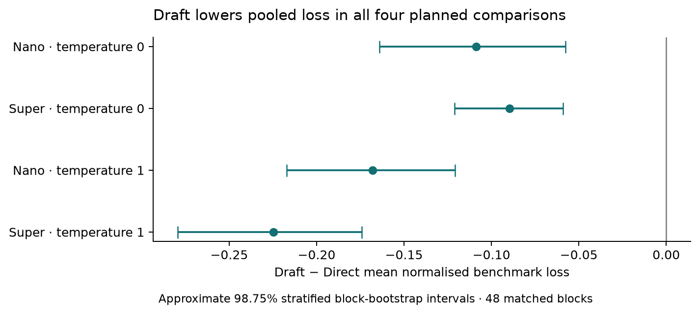

# Dilemma Dynamics

_Exploring AI strategies, incentives and cooperation. An interactive game laboratory studying NVIDIA Nemotron's choices. Submission to [Nebius x NVIDIA Global AI Hackathon (Best Apps and Agents Track)](https://nebiusglobalaihackathon.devpost.com)._

An AI agent's choices can influence whether a partner cooperates, retaliates or rebuilds a productive
relationship. Dilemma Dynamics allows to examine how individual decision quality relates to cooperation over time. Students can
explore the same incentives by playing repeated Prisoner's Dilemma and inspecting the consequences of each choice.

**[Try the browser demo](https://sheinkmana.github.io/dilemma-dynamics/#play)** ·
[Explore Results](https://sheinkmana.github.io/dilemma-dynamics/#results) ·
[Read the detailed PDF notes](public/research/paper/report.pdf)

The browser demo offers free play, analysis and labelled saved Nemotron recordings without an API key or model requests.
For live model play, [run the app locally](#run-locally).

**NVIDIA Nemotron Nano and Super, served through Nebius Token Factory**, made the
choices in the 7,104-episode evaluation. Token Factory supplied hosted inference
while the game engine, exact scoring and evaluation ran locally.

## Two-minute walkthrough

1. Open **[Play & understand](https://sheinkmana.github.io/dilemma-dynamics/#play)**,
   choose **Play yourself**, keep **Reciprocal bot · free**, and select
   **Start playing →**. Choose **Cooperate (C)** or **Defect (D)**; both players'
   private choices are revealed together. Use **Next round** to continue and see
   how the bot responds.
2. Read **Understand this decision** beside or below a completed round. Compare
   the payoffs and alternative actions, and use **Round history** to revisit a
   choice.
3. Select **Stop interaction**, then **New interaction**, then
   **Watch Nemotron · recording**. Use **Reveal next round** to inspect the saved
   Nano Direct example; switch to **Nemotron Nano · Draft** to compare the matched
   procedure. These are recorded actions, with no new inference requests.
4. Open **[Results](https://sheinkmana.github.io/dilemma-dynamics/#results)** for
   the three chart-led findings. Select **Explore a study replay ↓** to connect
   those aggregates to individual decisions and their exact payoff references.

## What the study shows

In the repeated Prisoner’s Dilemma, both players choose privately and reveal together. Mutual cooperation earns three points each; mutual defection earns one each. Defecting against a cooperator earns five, leaving the cooperator zero. Defection pays more immediately, but a responsive partner can make cooperation valuable over time. Each player seeks their own cumulative points.


The evaluation contains **7,104 episodes** (6,144 benchmark episodes and 960 autonomous-interaction episodes), **two models** and **two temperatures**.
Actions used neutral X/Y labels (not cooperate/defect), with both label assignments tested.

**Direct** requests one thinking-off action; **Draft** first requests a bounded thinking-on private draft,
then an action in a separate request. The study compares these complete procedures.

The 6,144 benchmark episodes use four disclosed opponent rules: Always Cooperate, Always Defect, Tit-for-Tat and Grim. Exact dynamic programming finds the best achievable expected own payoff for each choice. Decision loss is the normalised payoff forgone by an action, allowing optimal play afterward. The 960 autonomous-interaction episodes consider two model agents play each other.

Drafting reduced average exact benchmark decision loss by **16.8–37.5%** across
the four planned comparisons. **Decision loss measures payoff forgone relative
to exact best-response references against disclosed opponent rules.** The
reduction means less payoff forgone, rather than the same percentage increase in
earned points. The opponent matters: drafting increased loss against Tit-for-Tat
and reduced cooperation in autonomous self-play. Recognising an exploitation
opportunity and sustaining a reciprocal relationship are distinct capabilities.



Read the [evaluation guide](FINAL_EVALUATION.md) for findings and reproducibility,
or the [PDF notes](public/research/paper/report.pdf) for the study, mathematical
definitions and future work. The [TeX source](public/research/paper/main.tex) is
retained in the repository.

## More to explore

**Play & understand** also offers **Watch bots · free**, expandable lessons and
advanced setup. **Results** places detailed tables and methods below its charts
and optional Study replay.

**[Recreational games](https://sheinkmana.github.io/dilemma-dynamics/#recreational)**
is a separate secondary area. Tic-tac-toe and Dots & Boxes are mathematical games
played on discrete grids or lattices, with perfect information and visible
sequential moves. Try their tactics, play with bot, and search there.

Both website and local builds share this interface. The website supports free
play, analysis, saved recordings and replay exports without a key. The local
build additionally supports Nemotron model play through a localhost server. 
Browser games save locally when storage is available; reload pauses unfinished games until
Resume. One can download a replay to keep a separate copy.

## Run locally

Requires Node **22.18+ or 24** and npm. From the repository root:

```sh
npm ci
npm run build
npm start
```

Open **http://127.0.0.1:4317**. Free play, lessons, recordings and Results work
without a provider key. For development, run `npm run dev` and `npm run dev:web`
in separate terminals; Vite normally serves port 5173 and proxies the API to 4317.

For live Nemotron play, copy `.env.example` to the ignored `.env`, configure
`NEBIUS_API_KEY`, restart, and choose **Refresh models**. Select the models and
session settings, then explicitly start. Calls use your own provider account.
The server keeps the key private; the public website never embeds it.

Pause waits for a joint-round boundary. Stop awards no partial-round points.
Restart never automatically resumes model requests. Accepted sealed responses
are retained for supported recovery. After a browser disconnect, check the
connection and session status before restarting.

## How it works

**React interface → local Fastify coordinator → Nebius Token Factory.**
SQLite stores local sessions and request records. The public build uses a
separate browser runtime for free policies and static evidence. Analysis runs
outside the player decision loop.

The evaluation pipeline uses **Python 3.12**, **Inspect AI**, **HTTPX**, **NumPy**,
**PyArrow**, **Matplotlib** and local **MLflow Skinny/SQLite** tracking. Hosted
Nemotron models choose actions; deterministic code runs the game and calculates
exact payoff references. Roles, locked versions and mathematical definitions
are in the [evaluation guide](FINAL_EVALUATION.md).

| Location | Purpose |
| --- | --- |
| `src/web/` | Shared interface, browser runtime, replay and results. |
| `src/server/` | Local API, provider calls and session persistence. |
| `src/dilemma/`, `src/games/` | Rules, observations, analysis and recreational-game solvers. |
| `evaluation_v2/`, `evaluation_recovery/` | Executed evaluation and separately frozen recovery. |
| `python/gamefield_research/`, `fixtures/` | Exact scoring, schedules and frozen reference checks. |
| `public/research/` | Released actions, numeric data, figures and TeX/PDF notes. |
| `tools/` | Offline verification, protocol restoration and website checks. |
| `tests/`, `python_tests/`, `recovery_tests/` | App and network-free research checks. |
| `package-lock.json`, `uv.lock` | Reproducible dependency resolutions. |

The `gamefield_research`, `gamefield-study` and `GAMEFIELD_*` compatibility names
preserve installed packages, sessions and provenance. Private execution evidence
remains in ignored `output/`. A root `conftest.py` isolates one frozen legacy
test's retired public paths using a temporary reconstructed plan contract.

## Verify

Application and public-build checks make no inference calls:

```sh
npm test
npm run build
npm run build:public
npm run verify:public
```

For a **new checkout**, install the locked research environment and restore its
byte-preserved protocol input before the offline checks:

```sh
uv sync --frozen --all-extras
uv run python tools/restore_frozen_protocol.py
uv run python -m pytest python_tests recovery_tests -q
uv run python tools/verify_public_results.py
```

Preserve executed source, prompts, scoring and evidence. The completed campaign
can be reconstructed offline; the [evaluation guide](FINAL_EVALUATION.md)
explains the evidence and verification paths.

## Build the website app

```sh
npm run build:public
npm run preview:public
```

Open **http://127.0.0.1:4173/dilemma-dynamics/**. The default is **Play & understand**
(`#play`); **Results** is `#results`, with Study replay at `#replay`.
`#recreational` opens Recreational games. Existing `#dilemma` and `#analysis`
links still open the corresponding Play section. Changing tabs keeps game state.

Free play runs in the browser. The public build excludes model configuration,
server shutdown and inference transport; its build check rejects API endpoints
or event streams in compiled scripts.

Publish the contents of `dist/web/` under the website's `dilemma-dynamics/`
directory, with `LICENSE` copied as `LICENSE.txt`. The build uses an explicit
website asset allowlist: app assets, PDF notes, required figures and viewer data,
saved action recordings, and a checksum manifest. The repository retains the
full scientific export and TeX source. Research links on the website lead to
the PDF and this repository. Each build replaces `dist/web/`; export immediately
after `build:public`. Rebuilding this repository does not publish the website.

For Jekyll, exclude `dilemma-dynamics/**` from `jekyll-minifier`; Vite already
minifies the assets. Preserve the selected research assets and checksum manifest
byte for byte. Check free play, pause/resume, browser saves, replay, Results and
research links after copying the build.

## Storage, access and license

The live server binds to `127.0.0.1`, checks Host/Origin and requires a local
mutation token. Host the static public build on the website; keep credentials,
`data/`, raw drafts and operational evidence private. Report vulnerabilities
privately through repository security advisories.

[MIT](LICENSE) covers project code, original documentation and released data.
Dependencies and cited works retain their licenses. Nebius and NVIDIA marks
identify the services/models used and retain their own terms.
Logo sources: [Nebius](https://nebius.com/logo.svg) and
[NVIDIA](https://www.nvidia.com/en-us/about-nvidia/legal-info/logo-brand-usage/).
Retrieved 24 October 2026. NVIDIA's `n24-nvidia-logo` symbol is wrapped as a
standalone SVG with its artwork, proportions and colours retained.
