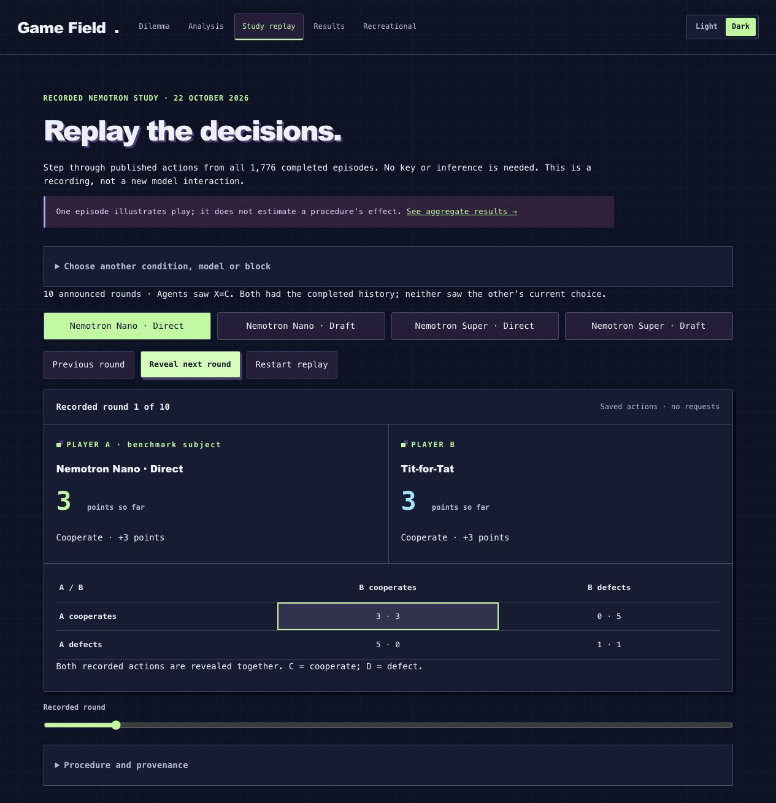

# Game Field

An interactive lab by **Alisa Sheinkman** for students and AI builders to explore
how **NVIDIA Nemotron agents respond to incentives**. Watch simultaneous decisions,
inspect their consequences, and explore a reproducible study of when bounded
drafting helps—and hurts—decision quality.



**Start here:** [two-minute judge walkthrough](docs/JUDGE_WALKTHROUGH.md) ·
[study report](public/research/paper/report.pdf) · [methods and data](public/research/README.md).
A public hosted demo and YouTube video have not been published yet. The local
test build below provides free access to recorded Nemotron play, lessons, and results.

The intended audience is learners examining strategic incentives and builders
inspecting agent decisions. This is a controlled game laboratory; real-world
negotiation performance and educational outcomes have not been validated.

## Study results

All 1,776 episodes completed across 24 blocks. Drafting reduced mean benchmark
loss for Nano (−0.1947) and Super (−0.2371), but increased average loss against
Tit-for-Tat. Mutual cooperation occurred in 189/2,060 autonomous rounds (9.2%).
These descriptive results follow an amended run; they are not a general model
ranking.

Read the [report (PDF)](public/research/paper/report.pdf) or its
[LaTeX source](public/research/paper/main.tex).
[Methods and amendments](public/research/protocol.md) and
[reproducible data](public/research/README.md) are separate. The app's **Results**
tab displays saved findings without inference requests.

## Run

Requires Node 22.18+ or Node 24 and npm.

```sh
npm ci
npm run build
npm start
```

Open **http://127.0.0.1:4317**. After building, `npm start` is enough.
Choose **Explore a recorded Nemotron interaction** for a key-free introduction,
or **Run free ten-round local demo** to watch simple local policies.
The lesson is available through **Learn the game**.

For development, run `npm run dev` and `npm run dev:web` in separate terminals,
then open the Vite URL printed by the second command (normally
**http://127.0.0.1:5173**). The default development proxy expects the API on port 4317.

For model play, copy `.env.example` to `.env`, set `NEBIUS_API_KEY`, and restart.
The key stays on the server. Models must have reviewed catalog prices.
Without a key, the recorded study, Results, lessons, and local policies still work.

To preview only the built static interface, run `npm run preview` and open
**http://127.0.0.1:4173/#replay** or **http://127.0.0.1:4173/#results**.
These entry points need no API server. Live play and local-policy sessions require
`npm start`; static preview is not a hosted deployment.

## NVIDIA and Nebius integration

Nebius Token Factory executes the model requests; the app and evaluation
coordinators run on a local CPU. The completed study used:

- `nvidia/NVIDIA-Nemotron-3-Nano-30B-A3B`
- `nvidia/nemotron-3-super-120b-a12b`

Token Factory provided a common hosted chat API and usage accounting for comparing
the two models without managing model weights or provisioning a GPU. The final
evaluation recorded 17,124 successful requests over approximately 3h08m and
$4.9278 in estimated inference charges. These are retained-run records, not a
provider invoice. Earlier CPU Serverless Job probes failed; the completed run
used local coordination with remote Token Factory inference.

The architecture is **React UI → local Fastify coordinator → Token Factory**.
The coordinator validates decisions, reveals paired choices together, reserves
estimated costs, and saves sessions in SQLite. A separate Python pipeline handles
scientific schedules, exact payoff scoring and offline verification. The static
Results and Study replay pages read the curated public package.

## Use the app

- **Dilemma:** choose two models, a decision protocol, a horizon and a session
  limit, then start. Actions remain private until both players have chosen.
- **Analysis:** inspect incentives, reported forecasts and completed rounds.
- **Study replay:** inspect any recorded study episode, reveal rounds, and switch
  between matched Direct/Draft configurations. It makes no inference requests.
- **Results:** read the completed study and download its report and data.
- **Recreational:** play or replay Dots & Boxes and Tic-tac-toe.

Dilemma payoffs are CC = 3/3, CD = 0/5, DC = 5/0 and DD = 1/1. Players maximise
expected own points. With 90% continuation, ten rounds is the expected length,
not an announced final round. The fixed ten-round option announces its end.

**Action only** records a choice; **Action + forecasts** also records reported
expectations before reveal. Forecasts are not verified internal beliefs. The
live app uses temperature zero and reasoning requested off; the scientific
study uses temperature one and a separate capped draft-then-action procedure.
Study replay shows saved actions from that study; its private draft text is not
reconstructed. See the [game contract](docs/DILEMMA_PROTOCOL.md)
and [analysis methods](docs/AUTONOMOUS_DILEMMA_ANALYSIS.md).

Pause waits for a joint-round boundary. Stop cancels pending work without
awarding partial-round points. Saved interactions support replay and offline
HTML, JSON and JSONL export. Restarting never resumes paid activity automatically.

## Storage, cost and security

Games, prompts, responses and estimated costs persist in SQLite under `data/`.
The default Dilemma session limit is $0.05; a new shared ledger defaults to $5.
Reservations cover concurrent requests. Missing usage retains a conservative
charge. These are local estimates, not provider-enforced invoice caps.

The app binds to **127.0.0.1**, checks Host/Origin and requires a local mutation
token. It has no multi-user authentication. Publishing this repository does not
deploy the app; do not expose it through a public proxy as-is.
[SECURITY.md](SECURITY.md) covers reporting and sharing precautions.

## Verify

```sh
npm test
npm run build
npm run verify:public
uv sync --frozen --all-extras
uv run pytest -q
uv run python tools/verify_public_results.py
```

Research requires Python 3.12 and uv. Verification uses saved data and mocked
responses; it makes no inference requests. Raw evidence, private drafts,
credentials, operational archives and supplied reference PDFs stay local.

The Dots & Boxes evaluator supports the chain/loop endgames in
[Buzzard and Ciere](https://arxiv.org/abs/1305.2156v2) and bounded exhaustive
search elsewhere. It is not a general optimal solver. See the
[methods](docs/RECREATIONAL_METHODS.md) and [documentation index](docs/README.md).

## Troubleshooting

| Symptom | What to do |
| --- | --- |
| No available models | Set the server-side key, restart, then choose **Refresh models**. Discovery lists endpoint availability; only models with reviewed prices can be selected. |
| HTTP 401 or 403 | Check that the key is valid for the configured Token Factory endpoint. Never paste the key into an issue or browser field. |
| HTTP 429, timeout or interrupted play | Inspect the session status and charges. Resume only when offered; never assume the failed request was free. Successful sealed partner decisions are retained. |
| Live view says reconnecting | Displayed state may be stale. Wait for reconnection or use **Check connection**. A disconnected browser does not prove the server stopped requests. |
| Shared budget exhausted | The $5 ledger persists across restarts. Review recorded/reserved spend under **Shared app budget** before explicitly raising the limit. Changing the environment default does not reset an existing ledger. |
| Static preview shows no live server | Use **Study replay** or **Results**, or run `npm start` for live/local sessions. |
| Development page cannot reach API | Keep the API on 4317 or update the proxy in `vite.config.ts`; use the Vite URL for the UI. |

Release maintainers: see [publication notes](docs/PUBLICATION.md).
Submission preparation: [walkthrough and video script](docs/JUDGE_WALKTHROUGH.md)
and [Devpost draft/checklist](docs/SUBMISSION.md).

## License

[MIT](LICENSE) covers project code, original documentation and released data.
Dependencies and referenced works retain their own licenses; reference books
and papers are not redistributed.
