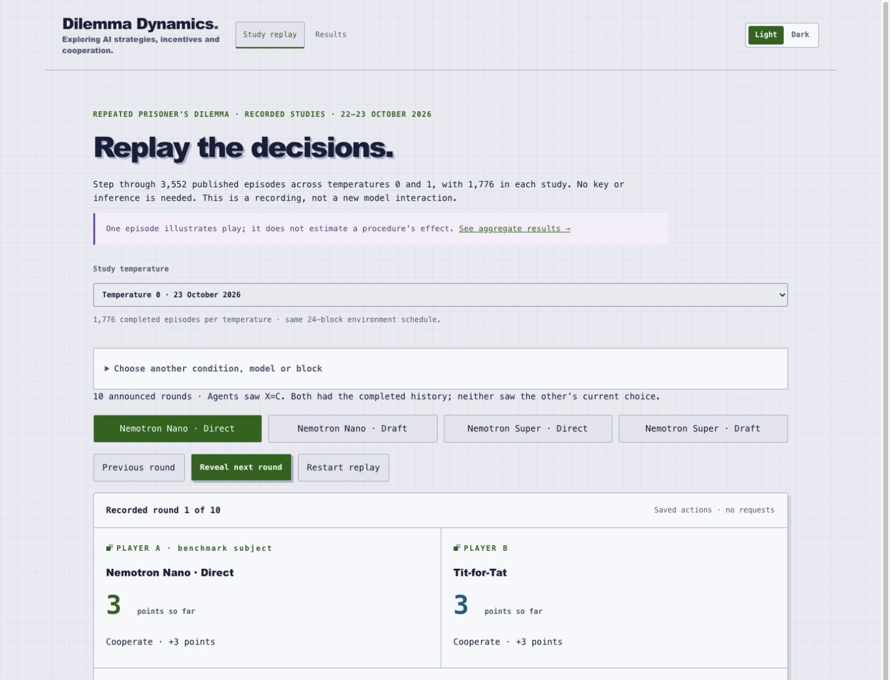

# Dilemma Dynamics

*Exploring AI strategies, incentives and cooperation.*

An interactive game laboratory by **Alisa Sheinkman**. Explore how incentives
shape AI decisions, inspect simultaneous choices and their consequences, and
compare bounded decision procedures in NVIDIA Nemotron Nano and Super.



The final evaluation is running: **7,104 episodes across temperatures 0 and 1**,
with native Inspect logs, local MLflow tracking and exact offline scoring.
No final findings are claimed yet. Bundled recordings and Results are earlier
development snapshots; the new verified evaluation will replace them together.
See [FINAL_EVALUATION.md](FINAL_EVALUATION.md) for the design, execution and
reproduction instructions, or the [technical notes (PDF)](public/research/paper/report.pdf)
and their [TeX source](public/research/paper/main.tex).

## Explore the app

1. **Dilemma:** open **Learn the game**, run the free ten-round demo, or choose
   **Play as a human** to face a random or reciprocal bot. The local API app also
   lets you choose Nemotron as your opponent.
   Both players choose privately and reveal together. Compare the immediate
   temptation to defect with the future value of cooperation.
2. **Analysis:** inspect the completed history, payoff arithmetic and alternative
   actions. Reported model forecasts, when requested, are distinguished from
   verified outcomes; a free policy demonstration does not invent forecasts.
3. **Study replay:** select a saved Nemotron episode, reveal rounds, and compare
   the same condition under Direct and Draft. Replay makes no model requests.
   One trajectory illustrates behaviour; aggregate comparisons belong in Results.
4. **Results:** inspect decision loss, opponent breakdowns, autonomous pairings,
   costs and downloadable evidence. During the current run, these are development
   data rather than the replacement final evaluation.
5. **Board games:** try Dots & Boxes or Tic-tac-toe. Choose **You (human)** for
   either seat, then click an empty cell or undrawn edge to play against a bot
   or, in the local API app, Nemotron. These visible, sequential,
   competitive games explore tactics and search. They are separate from the
   cooperation study, where mutual cooperation can improve both players' returns.

Both website and local builds share this interface. The website supports free
browser games, lessons, saved recordings, analysis and downloads without a key.
The local build additionally supports paid model play through a localhost server.
Browser games save locally when storage is available; reload pauses unfinished
games until Resume. Download a replay to keep a separate copy.

## Run locally

Requires Node **22.18+ or 24** and npm. From the repository root:

```sh
npm ci
npm run build
npm start
```

Open **http://127.0.0.1:4317**. Free demonstrations, lessons, recordings and
Results work without a provider key. For development, run `npm run dev` and
`npm run dev:web` in separate terminals; Vite normally serves port 5173 and
proxies the API to port 4317.

For live Nemotron play, copy `.env.example` to the ignored `.env`, configure
`NEBIUS_API_KEY`, restart, and choose **Refresh models**. Select priced models,
set a session limit and explicitly start. These calls can incur charges.
The server keeps the key private; the public website never embeds it.

Pause waits for a joint-round boundary. Stop awards no partial-round points.
Restart never automatically resumes paid requests. Accepted sealed responses
are retained for supported recovery. A disconnected browser does not prove the
server stopped; check connection and session status before restarting.

## Build the website app

```sh
npm run build:public
npm run preview:public
```

Open **http://127.0.0.1:4173/dilemma-dynamics/**. The default opens Study replay;
direct routes are `#dilemma`, `#analysis`, `#replay`, `#results` and `#recreational`.
Free play runs in the browser. The public build excludes model configuration,
server shutdown and inference transport; its build check rejects API endpoints
or event streams in the compiled scripts.

Publish the contents of `dist/web/` under the website's `dilemma-dynamics/`
directory, with `LICENSE` copied as `LICENSE.txt`. Each build replaces
`dist/web/`, so export immediately after `build:public`. Rebuilding this repo
does not publish the separate website.

For Jekyll, exclude `dilemma-dynamics/**` from `jekyll-minifier`; Vite already
minifies the assets. Preserve the curated research files and checksum manifest
byte for byte. Check free play, pause/resume, browser saves, replay, Results and
downloads after copying the build.

## How it works

**React interface → local Fastify coordinator → Nebius Token Factory.**
SQLite stores local sessions and accounting. The public build uses a separate
browser runtime for free policies and static evidence. Neither browser analysis
nor scientific scoring feeds advice back into a player.

The scientific pipeline uses **Python 3.12**, **Inspect AI**, **HTTPX**, **NumPy**,
**PyArrow**, **Matplotlib** and local **MLflow Skinny/SQLite** tracking. Hosted
Nemotron models choose actions; deterministic code runs the game and calculates
payoff references. There is no training, fine-tuning or local model/GPU hosting.
Exact roles, locked versions and mathematical definitions are in
[FINAL_EVALUATION.md](FINAL_EVALUATION.md).

| Location | Purpose |
|---|---|
| `src/web/` | Shared interface, browser runtime, replay and results. |
| `src/server/` | Local API, provider calls, session persistence and spending controls. |
| `src/dilemma/`, `src/games/` | Rules, observations, analysis and board-game solvers. |
| `evaluation_v2/` | Current joint-temperature final evaluation and native tracking. |
| `python/gamefield_research/` | Exact scoring, schedules and audited transport/recovery. |
| `fixtures/` | Frozen engineering decisions, reference checks and reviewed prices. |
| `public/research/` | Bundled actions, numeric data, figures and TeX/PDF notes. |
| `tools/` | Offline verification, frozen-protocol restoration and build checks. |
| `tests/`, `python_tests/` | Application and network-free research checks. |
| `package-lock.json`, `uv.lock` | Reproducible JavaScript and Python dependency resolutions. |

The `gamefield_research`, `gamefield-study` and `GAMEFIELD_*` compatibility names
are intentional; renaming them would break retained sessions or provenance.
Private evidence and evaluation output remain in ignored `output/`.

## Verify

Application and public-build checks make no inference calls:

```sh
npm test
npm run build
npm run build:public
npm run verify:public
```

For a **new checkout**, install the locked research environment and restore its
byte-preserved protocol input before the offline checks:

```sh
uv sync --frozen --all-extras
uv run python tools/restore_frozen_protocol.py
uv run python -m pytest -q
uv run python tools/verify_public_results.py
```

Do not sync dependencies, edit frozen sources or restart the active scientific
run for documentation/build work. [AGENTS.md](AGENTS.md) records those boundaries;
[FINAL_EVALUATION.md](FINAL_EVALUATION.md) contains the current run commands.

## Storage, access and license

The live server binds to `127.0.0.1`, checks Host/Origin and requires a local
mutation token. It has no multi-user authentication. Host only the static public
build on the website; keep credentials, `data/`, raw drafts and operational
evidence private. Local spending limits are estimates rather than provider
invoice caps. A key exposed accidentally should be revoked with its provider;
report vulnerabilities privately through repository security advisories.

[MIT](LICENSE) covers project code, original documentation and released data.
Dependencies and cited works retain their licenses. The locally hosted Nebius
and NVIDIA marks identify the services/models used; they are not covered by MIT.
Logo sources: [Nebius](https://nebius.com/logo.svg) and
[NVIDIA](https://www.nvidia.com/en-us/about-nvidia/legal-info/logo-brand-usage/).
Retrieved 24 October 2026. NVIDIA's `n24-nvidia-logo` symbol is wrapped as a
standalone SVG with its artwork, proportions and colours retained.
